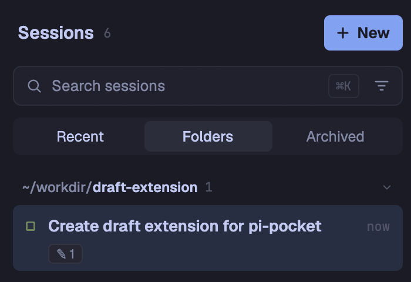
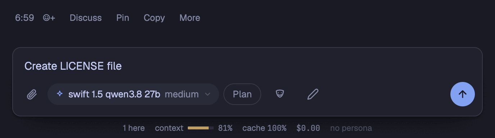
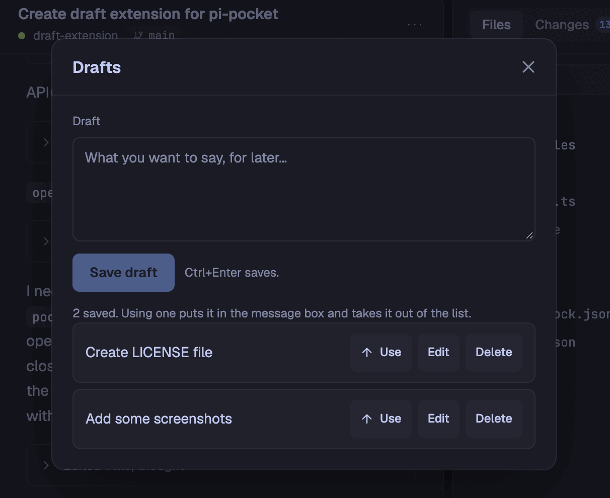

# Pi Pocket Drafts

A [Pi Pocket](https://github.com/TannerMidd/pi-pocket) extension for saving message drafts **per session**. Type something you want to say later, keep it out of the way, and put it back into the message box when the moment comes. Drafts live on the server, in a Pi Durable document per conversation, so they follow the session across tabs and devices.



## What you get

| Where | What |
| --- | --- |
| The message box's row | A pencil button that opens the **Drafts** sheet for the open session |
| The session's menu | A **Drafts** row whose hint says how many drafts the session has (`3 saved`) |
| The session list | A `✎ 2` chip under the title of every session that has drafts. Tapping it opens that session, then its Drafts sheet |



Inside the sheet:

- **Save** a draft from the field at the top (button or Ctrl/⌘+Enter). New drafts land on top.
- **Use** a draft: its text goes into the message box on a new paragraph, the sheet closes so the box shows, and the draft leaves the list. It is never sent; the person sends it, or not. Nothing touches the clipboard.
- **Edit** a draft: the row expands into a field prefilled with its text. Save overwrites it in place (Ctrl/⌘+Enter works here too); Cancel leaves it as it was.
- **Delete** asks twice, the way the app's own confirm buttons do: the first press arms the button red (`Delete it`), the second takes the draft out. Stepping away disarms it.



Everything stays current without reloading: the menu hint and the list's chips refresh on the module's own `drafts` events, which reach every tab of the person that loads the module, and on conversation changes.

## How it works

**Data.** One Pi Durable document per conversation, kind `x.drafts.list`:

```ts
{ drafts: { id: string; text: string; savedAt: number }[] } // newest first
```

Limits: 20,000 characters per draft (ends of whitespace trimmed), 100 drafts per session — the oldest goes when the list is full. `fork: "current"` keeps a fork's drafts in the fork.

**Routes** (owner only, as Pi Pocket's extension routes default):

| Method & path | Does |
| --- | --- |
| `GET list/:session` | The session's drafts, newest first |
| `POST drafts/:session` | Save one; answers with the new draft |
| `PUT drafts/:session/:id` | Overwrite one's text; it keeps its place |
| `DELETE drafts/:session/:id` | Remove one |
| `GET counts` | Which of your sessions have drafts, and how many — for the list's chips |

Every session is checked against what the person may see before it is read or written. Each mutation sends a `drafts` event to the tabs that load the module, which is how other tabs — and the menu hint and chips in this one — stay current.

**Browser module.** The sheet, the composer button, the menu row, and the session chips are added with Pi Pocket's browser API: `pocket.sheet`, `pocket.composerButton`, `pocket.menu` (`group: "session"`), and `pocket.sessionChips`. Putting a draft in the box uses `pocket.insertText`, which closes any open sheet so the message box shows. A chip tap navigates with `pocket.openConversation`; because sheets close when the conversation changes, the sheet opens from a one-shot `onConversation` listener once the tab shows that session — an intent whose navigation does not land in five seconds gives up.

The chips answer at once (the list requires it), so their counts come from a map the events keep current; each refresh hands the list a new function, as the API asks.

## Install

Drop the module and its folder into the data folder's extensions directory:

```
~/.pi-pocket/extensions/drafts.ts
~/.pi-pocket/extensions/drafts/        # index.js, style.css
```

Pi Pocket picks up new files on its own; turn the module on in **Menu → Extensions**. To remove it, take the files away and turn it off (or just delete them: a removed drop-in unloads).

## Repository layout

```
drafts.ts          the server module: the document, the routes, the client
drafts/            the browser module, served to the owner's tabs
  index.js         the sheet, the button, the menu row, the chips
  style.css        its look, in the app's theme tokens
_pocket.d.ts       a copy of Pi Pocket's public types (refreshed where installed)
docs/              the README's screenshots
test/              the test suite, see below
```

## Development and testing

The tests run the **real** route handlers against an in-memory doc store, and the **real** browser module against a mocked `pocket` (with the real preact + htm): 63 checks over routes, the sheet's flows, the menu hint, and the chips.

```sh
npm install
npm test
```

Node 24 runs `drafts.ts` with type stripping; no build step, as in Pi Pocket itself. Each test file is one process: `test/server.test.mjs`, `test/sheet.test.mjs`, `test/menu.test.mjs`, `test/chips.test.mjs`, over the shared `test/harness.mjs`.

## Requirements

- Pi Pocket with extension API version 1 (this module declares `pocketApi = 1`).
- The members it uses: `composerButton` and `insertText` (0.19.0), `sessionChips` and `onConversation` (0.20.0), and the menu row's `group` (0.21.0) — all marked experimental in Pi Pocket's reference, so they can change in a minor release. Each is guarded at runtime; an older app simply gets fewer entry points, and the sheet still works from wherever one shows.

## License

[MIT](LICENSE) — see the LICENSE file. Copyright (c) 2026 Yuki MIZUNO.
